<div align="center">



</div>

```
 ██╗    ██╗ █████╗ ██████╗ ███╗   ██╗██╗███╗   ██╗ ██████╗ 
 ██║    ██║██╔══██╗██╔══██╗████╗  ██║██║████╗  ██║██╔════╝ 
 ██║ █╗ ██║███████║██████╔╝██╔██╗ ██║██║██╔██╗ ██║██║  ███╗
 ██║███╗██║██╔══██║██╔══██╗██║╚██╗██║██║██║╚██╗██║██║   ██║
 ╚███╔███╔╝██║  ██║██║  ██║██║ ╚████║██║██║ ╚████║╚██████╔╝
  ╚══╝╚══╝ ╚═╝  ╚═╝╚═╝  ╚═╝╚═╝  ╚═══╝╚═╝╚═╝  ╚═══╝ ╚═════╝ 

  THIS PROFILE CONTAINS:
   [x] 0 working projects
   [x] 69 unread compiler warnings
   [x] 847 chrome tabs (do NOT ask which ones)
   [x] 1 (one) (1) repository (you are looking at it)
   [x] UNLIMITED vibes, ZERO documentation
  
  SIDE EFFECTS MAY INCLUDE: eye rolling, secondhand panic,
  sudden urge to close your own tabs, and mild concern for me.
```

<div align="center">

-238636?style=for-the-badge&logo=academia&logoColor=white)


-da3633?style=for-the-badge)


-d29922?style=for-the-badge)


[](https://www.youtube.com/watch?v=dQw4w9WgXcQ)


</div>

## 👨‍💻 `whoami`

<div align="center">
</div>

<br/>

Hi. I'm **Yurii** aka `Yuriii-dibs` (yes, three i's, no, I will not be explaining). I'm a **BSIT student** who got into tech because someone said *"you can make money typing"*. I have since learned typing is 5% of it and the other 95% is **screaming at a red squiggly line**.

> 🏷️ **Official title:** Ubet Licker *(not legally binding, not explained, not up for discussion)*

<div align="center">
</div>

---

## 🔥 THE DEBUGGING PROCESS (SCIENTIFICALLY ACCURATE)

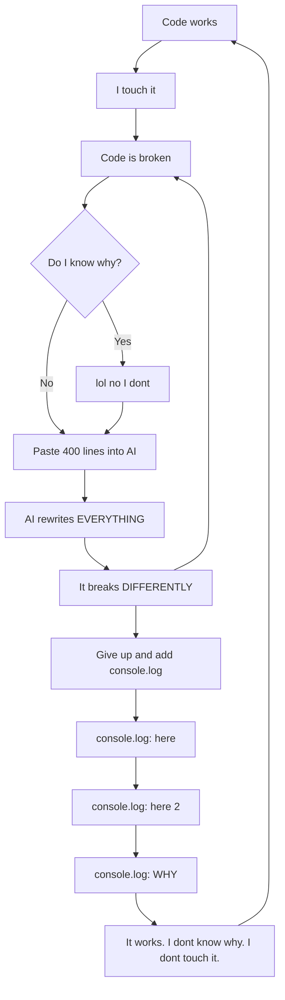

<div align="center">
</div>

---

## 🧠 WHAT'S IN MY HEAD (LIVE FOOTAGE, UNEDITED)

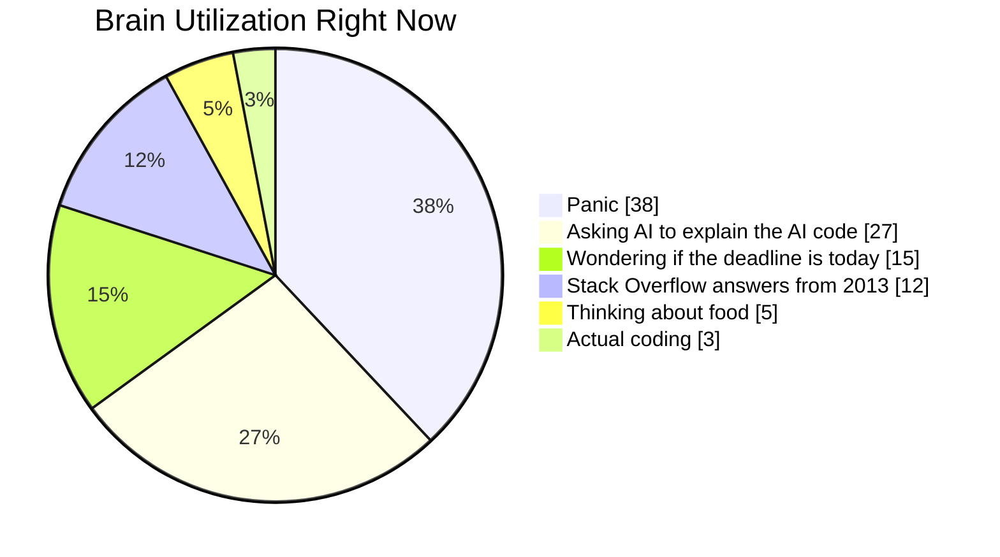

## 😭 A DAY IN THE LIFE

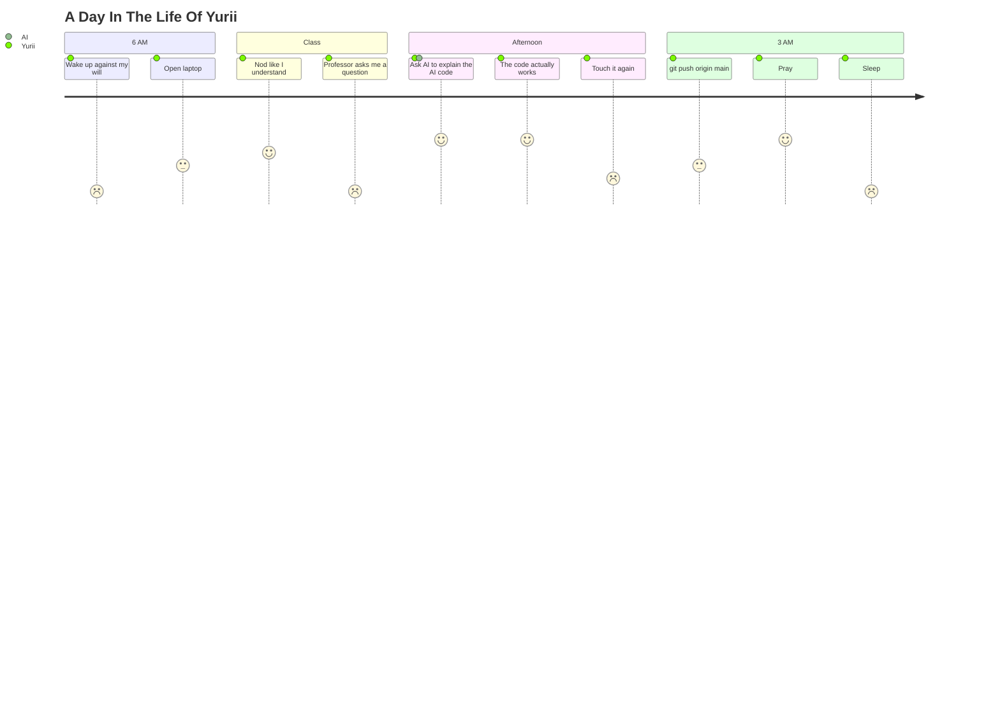

## 📉 CODE QUALITY MATRIX

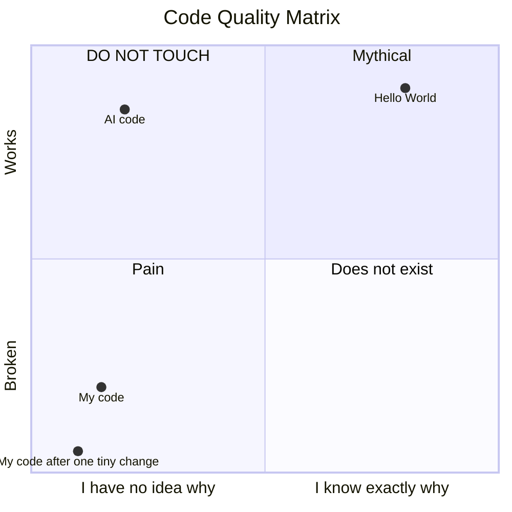

## 🌳 MY GIT HISTORY (A TRUE STORY)

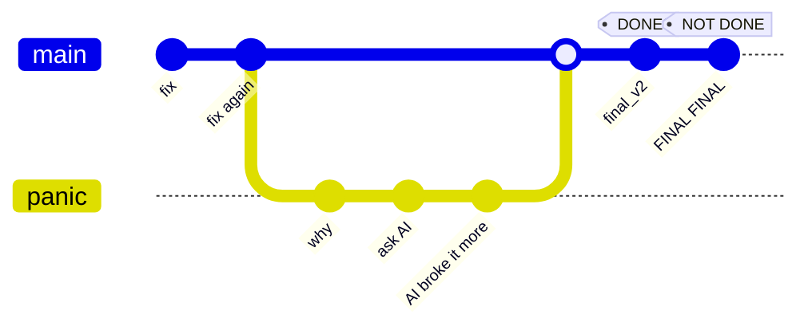

---

## 🏆 SKILL TIER LIST (SELF-ASSESSED, ZERO WITNESSES)

| Tier | Skill | Notes |
|:---:|---|---|
| 🥇 **S** | `Ctrl + C` / `Ctrl + V` | Black belt. Fastest hands in the west. |
| 🥇 **S** | Looking busy when the professor walks by | Alt-tab reflexes of a ninja. |
| 🥈 **A** | Nodding like I understand | 100% success rate until a follow-up question. |
| 🥈 **A** | Keeping 25+ tabs open | I will not be closing them. They are my children. |
| 🥉 **B** | `console.log("here")` | A legendary technique. Do not question it. |
| 🥉 **B** | Naming variables | `data`, `data2`, `data_final`, `data_final_REAL`, `data_final_REAL_v2_USE_THIS` |
| 💀 **C** | Compiling on the first try | Mythical. I have heard the legends. |
| 💀 **D** | Understanding my own code from yesterday | Past me was a stranger who hated future me. |
| ☠️ **F** | Reading documentation | I have tried. The words just slide off. |
| 🕳️ **F-minus** | Explaining line 23 | **NO COMMENT. MY LAWYER ADVISES SILENCE.** |

---

## 💥 ERROR POPUP SPAM (WINDOWS 98 EDITION)

<div align="center">
</div>

---

## 📜 MY GIT LOG (A CRIME SCENE)

```
$ git log --oneline

f3a9c1d fix
b72e0aa fix again
9d4c8e1 fixed the fix
1a2b3c4 why
e8f7a6b i swear this one works
c0ffee1 revert
d34db33f un-revert
5ca1ab1e asdfghjkl
0badf00d pls work i beg you
7a7a7a7 ok NOW it works (it does not)
abc1234 deleted everything and started over
deadbee final
deadbef final v2
deadbf0 FINAL FINAL (actually final)
ffffff1 i am so tired
ffffff2 i am so tired (but in main this time)
```

> `git push origin main` ← me, directly to main, no branch, no review, no fear, no brain.

---

## 🧾 PATCH NOTES v6.9.420 — *"The One Where Nothing Compiles"*

```diff
+ Added 12 new bugs
+ Added 3 more tabs (now 850, I'm so proud)
+ Added anxiety (it was missing)
- Removed 1 bug (introduced 4 more, net result: lose)
- Removed sleep schedule
- Removed dignity
~ Nerfed focus by 80%
~ Buffed procrastination, it is now OP
~ Rebalanced coffee intake (it is now 100%)
! KNOWN ISSUE: line 23 still unexplained
! KNOWN ISSUE: me
```

---

## 💘 DATING PROFILE (DEVELOPER EDITION)

| | |
|---|---|
| **Name** | Yurii |
| **Age** | 7 semesters of regret |
| **Hobbies** | Staring at the screen, long walks to the fridge, `git push --force` |
| **Looking for** | Someone who understands line 23 (please explain it to me) |
| 🟢 **Green flags** | Says sorry to the AI. Always saves the file. Mostly. |
| 🔴 **Red flags** | Pushes to main. Names files `final_final_v3`. Has 847 tabs open. |
| **Love language** | Fixing your bug at 3 AM and then breaking it again at 3:05 AM |

---

## 🎮 ACHIEVEMENTS UNLOCKED

- 🏅 **First Blood:** Got a syntax error before finishing the first line
- 🏅 **Semicolon Hunter:** Spent 2 hours finding one missing `;`. It was on line 1.
- 🏅 **Ctrl+Z Warrior:** Undid so much I went back to before I was born
- 🏅 **It Works On My Machine™:** Never leaving the machine
- 🏅 **Rubber Duck Certified:** Explained the bug to a duck. The duck judged me.
- 🏅 **Tab Collector:** Opened 25 Stack Overflow tabs, read zero
- 🏅 **The AI Whisperer:** Can type "fix" in 47 different emotional tones
- 🏅 **Final_Final_v3_REAL:** Named a file worse than anyone in history
- 🔒 ~~**Wrote code without help**~~ *(locked, requires skill)*
- 🔒 ~~**Went to bed before 3 AM**~~ *(locked, requires hope)*

---

## 🤖 HOW I ACTUALLY CODE

```diff
- Step 1: Read the problem
- Step 2: Think about the solution
- Step 3: Write the code
+ Step 1: Paste the problem into AI
+ Step 2: Paste the answer into my project
+ Step 3: Get an error
+ Step 4: Paste the error into AI
+ Step 5: AI apologizes (my favorite part)
+ Step 6: Repeat until the deadline or my soul leaves my body
```

> "I know what this does."
> — me, **not** knowing what this does

---

## 👨‍💻 H4CK3R M0DE

<div align="center">
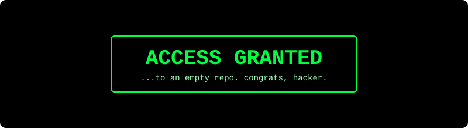
</div>

---

## 💀 SYSTEM FAILURE (PLEASE STAND BY)

<div align="center">
</div>

---

## 📊 THE OFFICIAL STATS

<div align="center">


<sub>*(if any of these cards fail to load, that is ALSO accurate)*</sub>

<br/><br/>


<br/>


</div>

---

## ❓ FREQUENTLY ASKED QUESTIONS (that nobody asked)

<details>
<summary><b>Q: Can you build my website/app?</b></summary>
<br/>
A: Sure! Just give me 3 weeks, a Wi-Fi connection, an AI subscription, a blessing from a priest, and your complete emotional support.
</details>

<details>
<summary><b>Q: Why is your code so messy?</b></summary>
<br/>
A: It's not messy, it's <b>modern abstract art</b>. You wouldn't understand.
</details>

<details>
<summary><b>Q: Do you know any programming languages?</b></summary>
<br/>
A: I know <code>Ctrl+C</code> and <code>Ctrl+V</code> fluently, <code>console.log</code> conversationally, and "the one the AI writes" at a native level.
</details>

<details>
<summary><b>Q: What does "Ubet Licker" mean?</b></summary>
<br/>
A: Classified. Above your clearance level. Do not ask again. 🍠💜
</details>

<details>
<summary><b>Q: Are you hiring?</b></summary>
<br/>
A: No. But I would gladly accept being hired. Please. The BSIT is not paying for itself.
</details>

<details>
<summary><b>Q: What is line 23?</b></summary>
<br/>
A: 🚪🏃💨
</details>

<details>
<summary><b>Q: Dear recruiter section?</b></summary>
<br/>

> Dear Recruiter,
>
> I am a highly motivated self-starter (the starter is broken, I push it by hand). I have 0 years of experience in 14 technologies and a deep commitment to console.log. I work well under pressure, mostly because pressure is the only time I work. Please hire me. I will pretend to understand the codebase for at least 3 months.
>
> Sincerely, Yurii (Ubet Licker)

</details>

<details>
<summary><b>🔒 SECRET SECTION (DO NOT OPEN)</b></summary>
<br/>

```
You opened it, didn't you.
Of course you did.
There's nothing here.
Go touch grass.
(I should too. I haven't in 3 semesters.)
```

</details>

---

## 🧾 TERMS AND CONDITIONS

By scrolling this README you agree that:

1. Nothing here is professional advice. **Please never take professional advice from me.**
2. All stats are made up. All statistics are fictional. All emotions are real.
3. If my code breaks your computer, it was **already broken** (and so was I).
4. You will not ask me what my code does.
5. Any resemblance to a functioning developer is purely coincidental.
6. I am legally allowed to say "it works on my machine."
7. The cat is not responsible for any of this.
8. The bugs are **not** a feature. (They are, but don't tell the professor.)

---

## 📡 CURRENTLY

```yaml
status: surviving
mood: tired but typing
learning: whatever the assignment is due for
building: this README (my only repository, my masterpiece)
looking_for: a bug-free life (will settle for a semicolon)
tabs_open: yes
fun_fact: this README has more personality than my code
```

---

<div align="center">


### 💬 Slide into my issues. I will not respond. But I will see them. 👀


<sub>© 2026 Yurii. All rights reserved. All bugs reserved too.</sub>

</div>
